# HomeServe Technologies – Entity Relationship Diagram (ERD)

This document visualizes the complete normalized relational schema across all 20 database entities in **HomeServe Technologies**.

---

```mermaid
erDiagram
    users ||--o| customers : "has profile"
    users ||--o| service_providers : "has profile"
    users ||--o| technicians : "has profile"
    users ||--o{ addresses : "saves"
    users ||--o{ notifications : "receives"
    users ||--o{ bookings : "creates as customer"
    users ||--o{ booking_assignments : "assigned as technician"

    service_categories ||--o{ services : "contains"
    service_providers ||--o{ provider_services : "offers"
    services ||--o{ provider_services : "offered by"
    service_providers ||--o{ service_areas : "operates in"
    service_providers ||--o{ availability_slots : "schedules"

    bookings ||--|| payments : "settled by"
    bookings ||--|| invoices : "generates"
    bookings ||--o{ booking_assignments : "dispatched to"
    bookings ||--o{ booking_images : "logged with"
    bookings ||--o| reviews : "rated in"
    bookings ||--o{ complaints : "disputed via"
    bookings ||--o| provider_earnings : "credits"
    coupons ||--o{ bookings : "discounts"

    users {
        int id PK
        string email UK
        string hashed_password
        string full_name
        string role
        string phone
        string city
        boolean is_active
        datetime created_at
    }

    customers {
        int id PK
        int user_id FK
        int loyalty_points
        string preferred_payment_method
        string emergency_contact
    }

    service_providers {
        int id PK
        int user_id FK
        string business_name
        decimal hourly_rate
        decimal commission_rate
        decimal average_rating
        int total_reviews
        boolean is_verified
    }

    technicians {
        int id PK
        int user_id FK
        string badge_number UK
        string skills
        string vehicle_type
        decimal rating
        boolean is_available
    }

    addresses {
        int id PK
        int user_id FK
        string street_address
        string city
        string state
        string zip_code
        boolean is_default
    }

    service_categories {
        int id PK
        string name UK
        string description
        string icon
        string image_url
        boolean is_active
    }

    services {
        int id PK
        int category_id FK
        string name
        decimal base_price
        int duration_minutes
        string image_url
        boolean is_active
    }

    provider_services {
        int provider_id PK,FK
        int service_id PK,FK
    }

    service_areas {
        int id PK
        int provider_id FK
        string city
        string state
        decimal radius_km
    }

    availability_slots {
        int id PK
        int provider_id FK
        int day_of_week
        time start_time
        time end_time
        boolean is_available
    }

    bookings {
        int id PK
        string booking_reference UK
        int customer_id FK
        int provider_id FK
        int service_id FK
        date scheduled_date
        time scheduled_time
        string status
        decimal subtotal
        decimal discount_amount
        decimal total_price
        int coupon_id FK
        string address
        string city
    }

    booking_assignments {
        int id PK
        int booking_id FK
        int technician_id FK
        int assigned_by_id FK
        string status
        datetime assigned_at
    }

    booking_images {
        int id PK
        int booking_id FK
        string image_url
        string image_type
        string caption
        datetime uploaded_at
    }

    payments {
        int id PK
        int booking_id UK,FK
        int user_id FK
        decimal amount
        decimal platform_fee
        decimal provider_amount
        string status
        string transaction_id UK
        boolean is_demo
    }

    invoices {
        int id PK
        string invoice_number UK
        int booking_id UK,FK
        int customer_id FK
        decimal total_amount
        string status
        date issued_date
    }

    coupons {
        int id PK
        string code UK
        string discount_type
        decimal discount_value
        decimal min_order_amount
        boolean is_active
    }

    reviews {
        int id PK
        int booking_id UK,FK
        int customer_id FK
        int provider_id FK
        decimal rating
        text comment
    }

    complaints {
        int id PK
        string ticket_number UK
        int booking_id FK
        int customer_id FK
        string priority
        string status
        string resolution
    }

    notifications {
        int id PK
        int user_id FK
        string title
        text message
        boolean is_read
        string link
    }

    provider_earnings {
        int id PK
        int provider_id FK
        int booking_id UK,FK
        decimal gross_amount
        decimal platform_fee
        decimal net_earnings
        string status
    }
```

