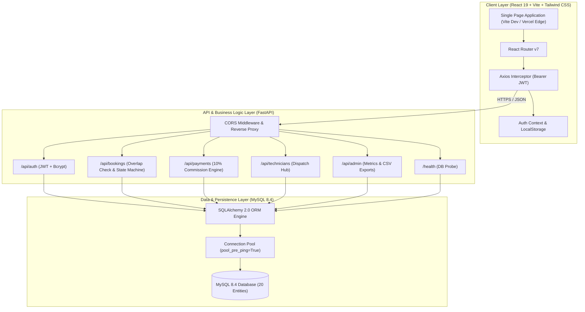
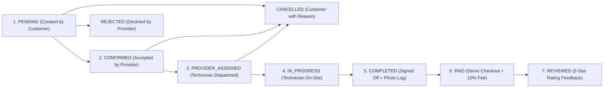
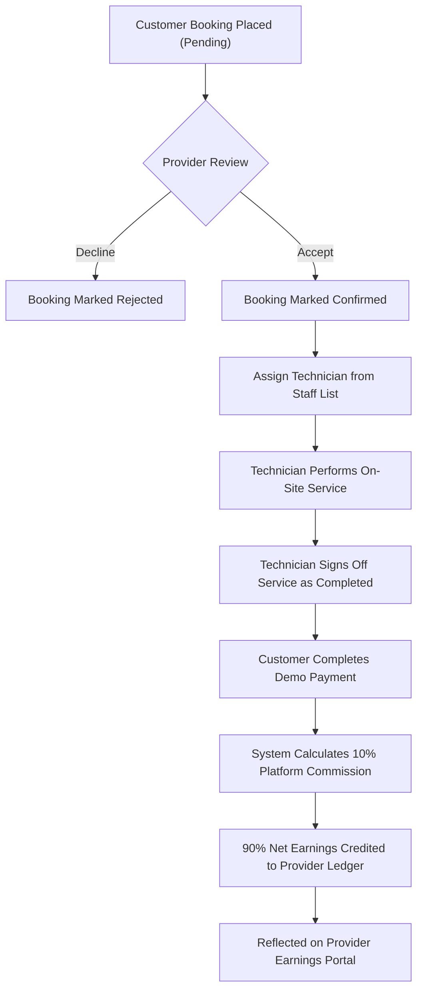
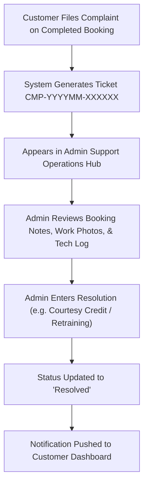

# HomeServe Technologies – Comprehensive Project Flow & Architecture

This document contains architectural diagrams, sequence flows, and lifecycle state machines detailing how data and events traverse **HomeServe Technologies**.

---

## 1. High-Level System Architecture



---

## 2. End-to-End Customer Booking Sequence Flow

```mermaid
sequenceDiagram
    autonumber
    actor Customer
    participant Frontend as React Frontend
    participant API as FastAPI Backend
    participant DB as MySQL Database
    actor Provider
    actor Technician

    Customer->>Frontend: Select Service & Provider
    Frontend->>API: GET /providers/{id}/availability
    API->>DB: Query active availability slots
    DB-->>API: Return operating hours
    API-->>Frontend: Display open slots

    Customer->>Frontend: Enter Promo Code "WELCOME20"
    Frontend->>API: POST /coupons/validate
    API->>DB: Verify minimum order & usage limit
    DB-->>API: Valid (-20% discount)
    API-->>Frontend: Display final subtotal

    Customer->>Frontend: Submit Booking Reservation
    Frontend->>API: POST /bookings (date, time, address)
    API->>DB: Execute Concurrency Overlap Check
    alt Overlap Detected
        API-->>Frontend: HTTP 409 Conflict ("Time slot overlapping")
    else Slot Free
        API->>DB: INSERT booking (status: 'pending')
        DB-->>API: Booking ID & Reference HS-BK-...
        API-->>Frontend: HTTP 201 Created
    end

    Provider->>Frontend: View Incoming Orders
    Frontend->>API: PATCH /bookings/{id}/status (status: 'confirmed')
    API->>DB: Update booking status to 'confirmed'
    API-->>Frontend: Booking Confirmed

    Provider->>Frontend: Dispatch Field Technician
    Frontend->>API: POST /bookings/{id}/assign (tech_id)
    API->>DB: INSERT booking_assignment; status = 'provider_assigned'
    API-->>Frontend: Assignment Recorded

    Technician->>Frontend: Mobile Console - Mark Arrived & Start
    Frontend->>API: PATCH /bookings/{id}/status (status: 'in_progress')
    API->>DB: Update status to 'in_progress'

    Technician->>Frontend: Log Before/After Photo & Complete
    Frontend->>API: POST /bookings/{id}/images
    Frontend->>API: PATCH /bookings/{id}/status (status: 'completed')
    API->>DB: Record photo log; set status = 'completed'

    Customer->>Frontend: Sandbox Demo Payment
    Frontend->>API: POST /payments/process-demo
    API->>DB: Calculate 10% Platform Fee & 90% Provider Payout
    API->>DB: Auto-generate Tax Invoice INV-YYYYMM-...
    API-->>Frontend: Payment Success & Invoice Modal

    Customer->>Frontend: Post 5-Star Review
    Frontend->>API: POST /reviews
    API->>DB: INSERT review & recalculate provider avg rating
    API-->>Frontend: Review Recorded
```

---

## 3. Booking Lifecycle State Machine Flow



---

## 4. Provider Lifecycle & Financial Settlement Flow



---

## 5. Dispute & Complaint Resolution Flow


